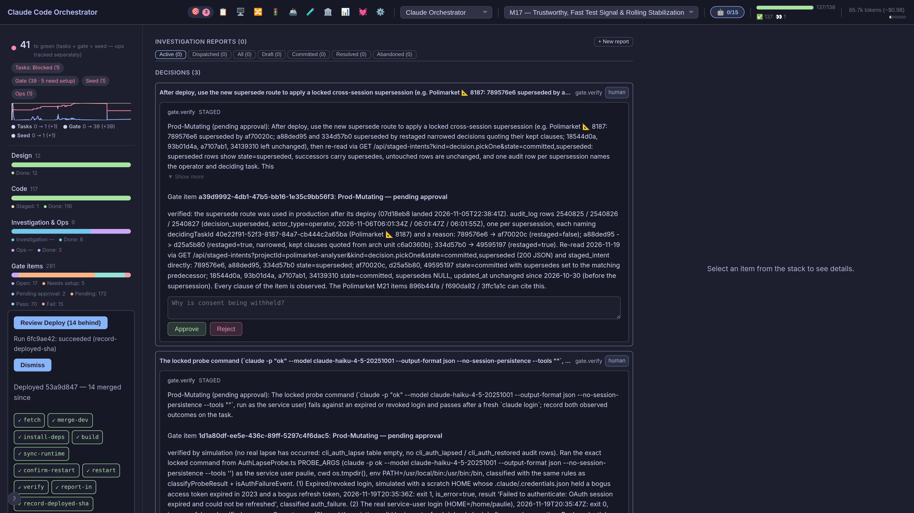
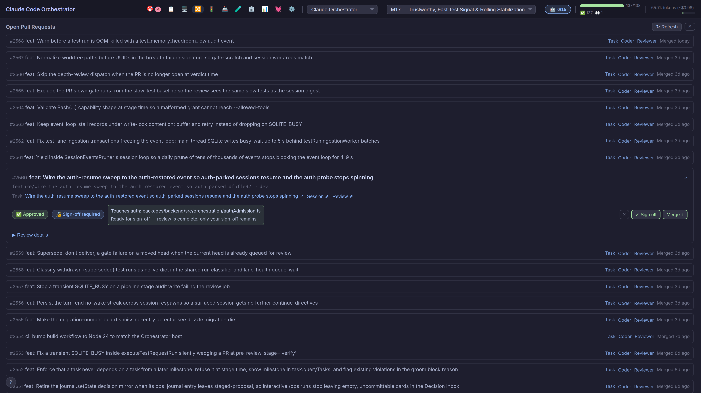
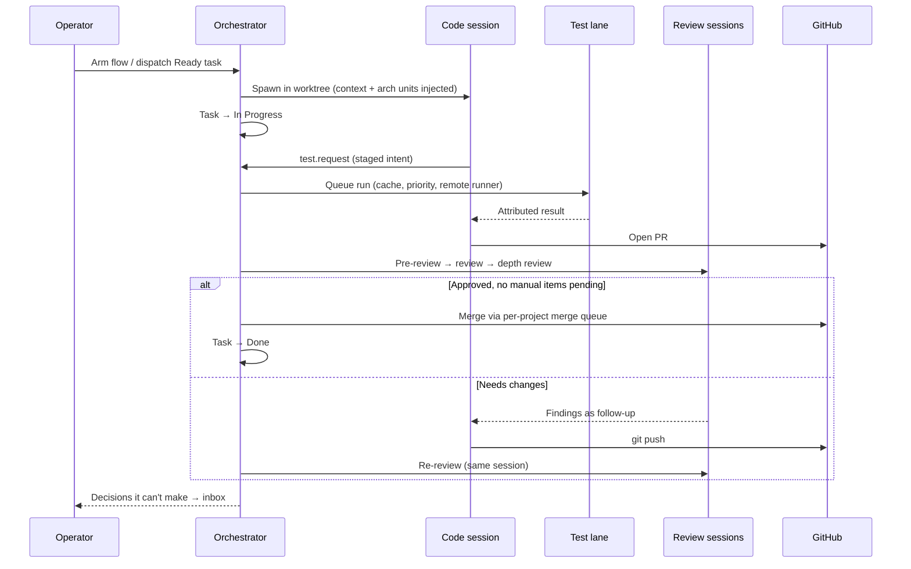
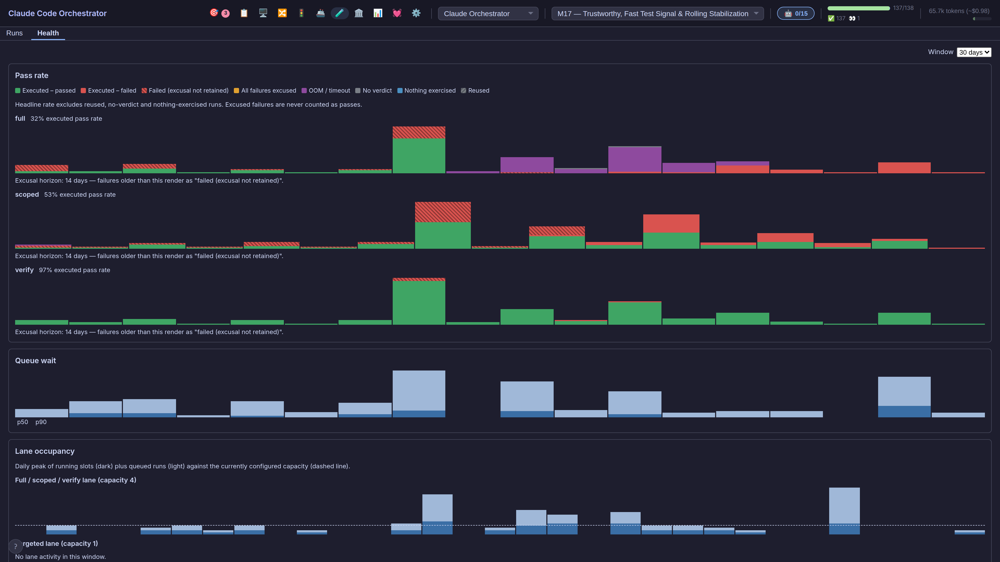
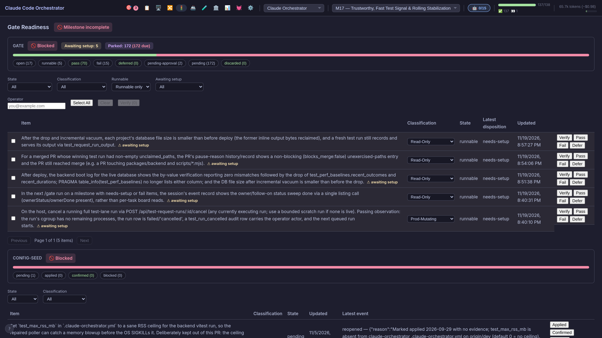
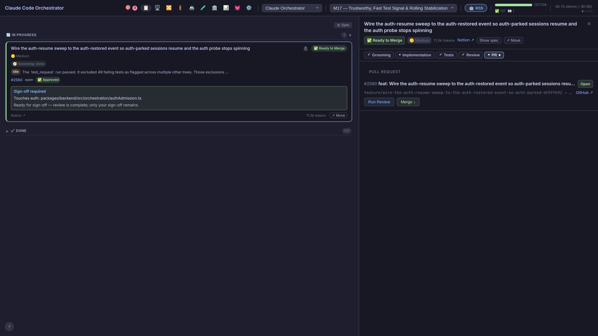
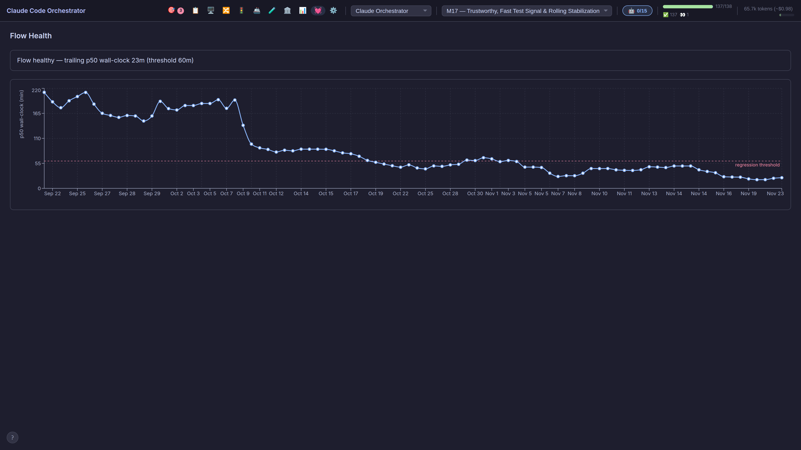
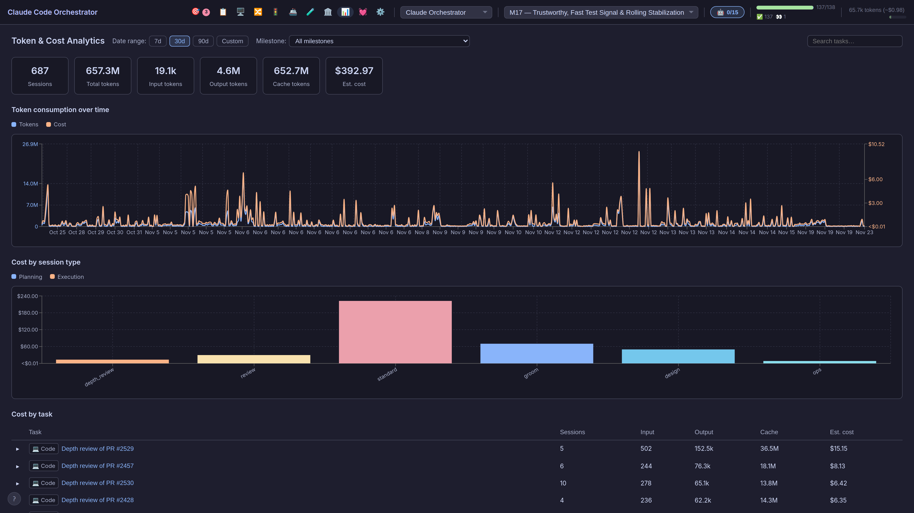

# Claude Code Orchestrator

A self-hosted control plane that runs [Claude Code](https://docs.anthropic.com/en/docs/claude-code) agents as a software-delivery team. It grooms a backlog, dispatches parallel coding sessions into isolated git worktrees, tests their work on a governed test lane, reviews and merges their pull requests, verifies each milestone, and runs confirm-gated deploys and releases. One rule holds throughout: **agents propose and the orchestrator disposes.** Every state-changing decision an agent makes is staged as a typed intent. It is applied only by a human, or by an auto-approval standard the system has earned.

It started as a read-only browser for Claude Code session history and was then built using itself: 2,700+ commits across sixteen shipped milestones. It also runs its owner's other projects, including a large Python data system and a TypeScript/.NET app.



## What it does

- **Dispatch.** Turns `🗂️ Ready` tasks from Notion, GitHub Issues, Jira, or local YAML into parallel Claude sessions. Each session runs in its own worktree, and work is ordered by dependency and execution priority (Execute Now / Urgent / Blocker).
- **Test.** Sessions never run test suites directly. They request a run through a test lane with per-project queues, memory admission, a content-hash result cache, and an optional remote runner host. A failing test is attributed as a flake, a base-branch break, or a genuine regression before it blocks anyone.
- **Review and merge.** Every PR gets an analyze/verify pre-review, a persistent review session, and a depth review pass (security, concurrency, reliability, data integrity). Findings go back to the implementing session. Approved PRs merge through a per-project serialized merge queue, which holds any PR whose manual-verification items are still open.
- **Plan.** Grooming, design, ops, investigation, and docs work run as their own dispatched session types. Each can be armed per milestone to run unattended, and each stages its output for disposition rather than writing it.
- **Converge.** A milestone view rolls design, grooming, code, investigation, ops, and gate progress into one burndown. Next to it sits a decision inbox and a Manual Verification Gate that tracks each milestone-end check through to a disposition.
- **Ship.** YAML deploy playbooks run step by step with confirm gates, verification, and compensating rollback. An automated wrap playbook closes a milestone: it carries gate items forward, advances `dev` → `main`, and cuts the release tag.
- **Observe.** You can watch sessions live with token and cost tracking, browse full session timelines, and check fleet, test-health, and flow-health views. A full audit log records every disposition, merge, and scheduler run.



## Design highlights

- **Staged intents, not direct writes.** A dispatched session writes through the orchestrator's own MCP tools (`task.setStatus`, `arch.createUnit`, `gate.verify`, `test.request`, …), and each call stages a typed `staged_intent` row instead of applying it. Intents can be committed atomically as groups, and several kinds can only ever be applied by a human. A server-side promotion gate checks size, type, seams, dependencies, file scope, and verification items before any task can reach `Ready`.
- **Earned autonomy.** A session never gets authority by default. It is auto-approved only against an articulated standard: clean-verdict standards for planning work, and grooming-standard checks with a size backstop and path _tripwires_ for Code tasks. Anything touching CI, migrations, auth, or secrets escalates to a human regardless. Auto-approvals are attributed to `system`, can be reverted from a feed, and are measured by reversal rate.
- **Deny-by-default tool permissions.** Every session gets a spawn-time `--allowed-tools` allowlist (a base set plus per-project `.claude-orchestrator.yml` extensions) and a filesystem baseline for its session type. Any call outside the list is denied and logged. A session that needs more stages a `session.requestCapability` intent. The operator, or a sanctioned auto-approve policy, grants it, and every grant carries provenance.
- **Persistent review sessions.** Each PR keeps one review session for its whole lifetime. Re-reviews are follow-up messages on that session, so the reviewer builds up context across iterations.
- **Architecture as a store.** Architecture decisions live in an orchestrator-owned unit store, and each unit has a region envelope and an append-only history. A session receives the units that intersect its task's files plus all global invariants, and can query the rest on demand.
- **Backend owns the lifecycle.** Task status, session start and stop, PR linkage, and session completion are all derived and written server-side, never by the agent.

## Quick taste

The permission model, from `packages/backend/src/config.ts` and `ApiSessionRunner.ts`:

```ts
// A base allowlist, extended per project by .claude-orchestrator.yml:
export const ALLOWED_TOOLS = [
  ...ARCHITECTURE_READ_MCP_TOOLS,
  'Bash(git:*)',
  'Bash(npm:*)',
  'Bash(node:*)',
  'Bash(tsc:*)' /* … */,
];

// canUseTool only fires for calls NOT already covered by allowedTools — deny them.
canUseTool: async (toolName, input) => ({
  behavior: 'deny',
  message: `Tool '${toolName}' is not in the allowed tools list`,
});
```

No UI permission prompt appears mid-session. A call is either already allowed, or it is denied and logged to `permission_denials`. More access arrives only through a staged, attributable capability grant.

## How it works

When a task is dispatched, by you or by an armed flow, the backend spawns a Claude session through one of three interchangeable `ISessionRunner` implementations: `CliSessionRunner` (the `claude` CLI), `ApiSessionRunner` (the Agent SDK), or `DockerSessionRunner` (a sandboxed container behind an egress proxy). The session runs in its own worktree under `.claude/worktrees/<sessionId>` and streams its events back over a typed WebSocket protocol.



| Layer             | Tech                                                | Path / notes                                                                        |
| ----------------- | --------------------------------------------------- | ----------------------------------------------------------------------------------- |
| Frontend          | React 19 + Vite (TypeScript)                        | `packages/frontend/`                                                                |
| Backend           | Node.js + Express (TypeScript)                      | `packages/backend/`                                                                 |
| Transport         | WebSocket (`ws`), typed message unions              | `packages/backend/src/ws/types.ts`                                                  |
| Database          | SQLite (`better-sqlite3`)                           | sessions, PRs, staged intents, architecture units, gate items, test results, audit  |
| Task source       | Notion REST API, GitHub Issues, Jira, or local YAML | configured per project                                                              |
| Session execution | `claude` CLI subprocess, Agent SDK, or Docker       | one `ISessionRunner` per session                                                    |
| Orchestrator MCP  | in-process MCP server, per-session credentials      | `packages/backend/src/mcp/`: the read tools and the staged-write tools sessions use |
| Test lane         | local or remote runner (TLS pull channel)           | `packages/backend/src/orchestration/`                                               |
| Deploy engine     | YAML playbooks with confirm gates and rollback      | `packages/backend/src/deploy/`                                                      |



## Planning, dispatch & the decision surface

- **Dispatched planning.** `groom`, `design`, `ops`, `investigate`, and `docs` each run as their own session type against a milestone's board, with a tool envelope narrowed to that job. Each one ends by staging intents or a declared no-op. It never ends by writing state.
- **Per-flow arm toggles.** Each milestone arms or disarms each flow (`groom`, `design`, `ops`, `gate-verify`, `investigate`, `docs`) independently. A dispatch-trigger evaluator, with backpressure and a crash budget, picks up eligible work for the armed flows. Auto-dispatch is not auto-apply.
- **Decision inbox.** Staged intents, capability requests, gate conclusions, and investigation reports all land in one inbox. There you can approve, reject, push back, answer a question, or batch-approve a set of clean verdicts.
- **Ad-hoc investigation.** You can file a symptom (with screenshots), or a code session can file one with `report.file`. A dispatched investigate session then turns it into grounded backlog tasks.
- **Manual Verification Gate.** A `gate_item` store holds each milestone's verification items, each with a classification, a pending/backoff state, and a disposition history. Items are verified by gate-verify sessions or interactively via the `/gate` skill.



## Quickstart

**Prerequisites**

- Node.js 20 LTS or newer, and npm (`.nvmrc` pins 20; CI and the reference host run 24)
- [`claude`](https://docs.anthropic.com/en/docs/claude-code) CLI installed and authenticated (`claude login`)
- A GitHub PAT with `repo` scope (for PR tracking and merging)
- A Notion integration token, if you use Notion as a task source
- [`gitleaks`](https://github.com/gitleaks/gitleaks) ≥ 8.x (macOS: `brew install gitleaks` · Windows: `choco install gitleaks`), used by the `analyze:` gate for secret scanning

**Happy path**

```bash
git clone https://github.com/phahadek/claude-orchestrator.git && cd claude-orchestrator
npm install
git config blame.ignoreRevsFile .git-blame-ignore-revs      # once per clone — hides mass-format commits from blame
cp packages/backend/.env.example packages/backend/.env       # then edit
npm run dev    # → http://localhost:5173 (Vite proxies API/WS to the backend on :3000)
```

See [`docs/install.md`](docs/install.md) for Docker, production builds, the env var reference, and task-source setup.

### Configure your first project

Projects and milestones are managed in the dashboard and stored in SQLite. There is no `PROJECTS` env var to populate, and no restart is needed after a change.

1. Open **Settings → Projects → Add project**. Enter the name, the absolute path to the local repo (`projectDir`), the GitHub `owner/repo`, and a **task source**:
   - **Notion**: paste the Project Context page URL. The form marks it optional, but Notion projects need it in practice. See [`docs/notion-template.md`](docs/notion-template.md).
   - **GitHub**: Issues organized by label and milestone. See [`docs/github-template.md`](docs/github-template.md).
   - **Jira**: issues under an Epic per milestone. See [`docs/jira-template.md`](docs/jira-template.md).
   - **YAML**: tasks live in `<projectDir>/tasks.yaml` (gitignored by default). See [`docs/yaml-template.md`](docs/yaml-template.md).
2. Open **Settings → Milestones → Add milestone**. For Notion, paste each milestone board's **database ID**: the 32-character hex string from the database URL, not from a parent page.
3. Optionally add a `.claude-orchestrator.yml` to the repo for verify/test commands, the `analyze:` gate, and allowed-tools extensions. See [`docs/orchestrator-config.md`](docs/orchestrator-config.md).
4. The Tasks panel shows the selected milestone. Click **Dispatch** on a `🗂️ Ready` task, or arm a flow on the Milestone view to let it run.







## Deployment

- **`npm start`** runs the compiled backend (`node packages/backend/dist/server.js`), which serves the built frontend from the same process and port.
- **Deploy playbooks.** `<projectDir>/.claude-deploy-playbook.yml` declares preconditions, ordered steps, verification, rollback, and hazards. The deploy engine runs it, with a confirm gate before each production-mutating step, through the dashboard or the `/deploy` skill. Steps can optionally run on a remote host over SSH. This repo ships the playbook for its own self-hosted deployment.
- **Milestone wrap.** An orchestrator-owned `wrap` playbook (`POST /api/wrap/launch`) marks the milestone wrapped, carries pending gate items forward, repoints auto-launch, merges `dev` into `main`, and cuts the release tag. See [`RELEASE.md`](RELEASE.md).
- **Installers.** `installers/linux/` ships a systemd unit (`orchestrator.service`), a DB backup timer, and `.deb`/`.AppImage` build scripts. `installers/macos/` and `installers/windows/` build a `.dmg` and an Inno Setup installer.
- **Auto-updater.** It polls GitHub Releases and surfaces a new version within 24 hours of a release.

## Documentation

- [Product Design](docs/design.md): user goals, workflows, UI layout, and resolved design decisions
- [Technical Architecture](docs/architecture.md): stack, project structure, key systems, data flow, SQLite schema
- [Coding Guidelines](docs/coding-guidelines.md): architectural rules, naming, patterns, git etiquette
- [ESLint Conventions](docs/eslint-conventions.md): when to fix vs. disable a lint rule
- [Task Writing Guidelines](docs/task-writing.md): how to scope and write tasks for this orchestrator
- [Install guide](docs/install.md): production setup and env var reference
- [`.claude-orchestrator.yml` reference](docs/orchestrator-config.md): per-project session config, including pre-PR gate commands, the `analyze:` gate, allowed-tools extensions, and bash rules
- [Docker mode: operator setup](docs/docker-mode/operator-setup.md): sandboxed per-session containers behind a restricted egress proxy
- [Notion](docs/notion-template.md), [GitHub](docs/github-template.md), [Jira](docs/jira-template.md) ([task writing](docs/jira-task-writing.md)), and [YAML](docs/yaml-template.md) templates: task-source setup
- [Orchestrator project setup](docs/orchestrator-project-setup.md): point the orchestrator at an external project (C#, Rust, Godot, …)
- [`RELEASE.md`](RELEASE.md): the `dev` → `main` release process and the auto-updater's version contract
- [`CHANGELOG.md`](CHANGELOG.md): notable changes per release
- [`installers/`](installers/): per-OS build guides

## Skills & Remote Control setup

The interactive, operator-driven session types are Claude Code skills, source-controlled in [`skills/`](skills/):

| Skill                                | Purpose                                                                       |
| ------------------------------------ | ----------------------------------------------------------------------------- |
| `/groom`, `/design`                  | Bring backlog to Ready; execute design tasks and lock decisions               |
| `/ops`, `/investigate`               | Operational and investigation work; turn a live symptom into grounded backlog |
| `/gate`                              | Run a milestone's Manual Verification Gate                                    |
| `/deploy`                            | Run a project's deploy playbook, confirm-gated                                |
| `/docs`                              | Author a 📝 Docs task into a repo file or Notion page                         |
| `/milestone-seed`, `/milestone-wrap` | Stand up a new milestone; triage and close one out                            |
| `/wrap`                              | Persist a session's durable decisions before it ends                          |
| `/sync-guidelines`                   | Re-vendor all of the above into a live tree                                   |

- **Vendoring is always a reconcile, never a copy.** `/sync-guidelines` vendors the skills, the route-client scripts (`scripts/*.mjs`, `packages/backend/scripts/*-client.mjs`), the guideline docs (`procedures.md`, `task-writing.md`), and the config-tree hooks into the live tree. It does this as a confirm-gated three-way merge against a recorded baseline, which preserves local edits such as a refined skill instruction, a hotfix, or a filled-in project index. Run `node ~/.claude/scripts/sync-guidelines-load.mjs` for the deterministic plan step. On a fresh host, run `/sync-guidelines` once to seed everything.
- **Grooming manifests** live in the central config tree at `config/projects/<repo-dir>/grooming.json`, outside the repo. They resolve via `$ORCHESTRATOR_CONFIG_DIR` / `--config-dir`, or a host-aware default: a `config/` directory beside the projects root. See `skills/groom/reference/manifest.example.json`.
- **Remote Control server.** Launch it with `claude --permission-mode acceptEdits remote-control` from the **projects root**. The `remote-control` subcommand doesn't accept `--settings`, so context is delivered by hooks instead.
- **One-time hook registration** in `~/.claude/settings.json`. `/sync-guidelines` never edits user-global settings, so register these yourself:

  ```json
  {
    "hooks": {
      "SessionStart": [
        {
          "matcher": "",
          "hooks": [
            {
              "type": "command",
              "command": "node /path/to/config/hooks/load-procedures.mjs"
            },
            {
              "type": "command",
              "command": "node /path/to/config/hooks/inject-code-session-rules.mjs"
            }
          ]
        }
      ],
      "PreToolUse": [
        {
          "matcher": "mcp__claude_ai_Notion__notion-create-pages",
          "hooks": [
            {
              "type": "command",
              "command": "node ~/.claude/scripts/check-task-status.mjs"
            }
          ]
        }
      ]
    }
  }
  ```

  - `load-procedures.mjs` injects the universal `procedures.md`, but only at the projects root.
  - `inject-code-session-rules.mjs` injects the code-session rules, but only in orchestrator worktrees (`<projectDir>/.claude/worktrees/<uuid>`). Without it, dispatched Code sessions never get those rules.
  - `check-task-status.mjs` blocks creating a task at any status other than `🔲 Backlog`.

- **Non-dev layouts.** If the config tree isn't beside the projects root, set `ORCHESTRATOR_CONFIG_DIR` and `ORCHESTRATOR_PROJECTS_ROOT`. The systemd unit in the config tree sets both.

## License

[MIT](LICENSE)
